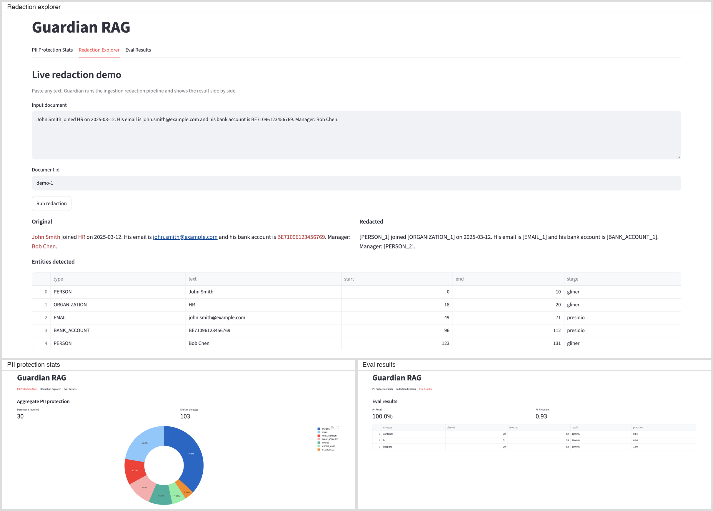
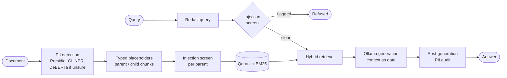

# Guardian RAG

A RAG pipeline for teams that must answer questions over documents full of personal data: PII is detected and replaced with typed placeholders before anything is indexed, queries and documents are screened for prompt injection, and every answer is audited for leaks before it is returned.

[](https://github.com/adel-saoud/guardian-rag/actions/workflows/ci.yml)
[](pyproject.toml)
[](LICENSE)

## Why

Most RAG pipelines embed documents as they are, so names, IBANs and passport numbers end up in the vector store and in the prompt. Guardian pseudonymizes PII at ingestion with typed placeholders (`[PERSON_1] reported to [PERSON_2]`), so retrieval still works on the redacted text, and re-checks every answer before it leaves.

I built it after running RAG over internal documents for a large organisation, where the hard question was never retrieval quality. It was what happens when a document contains a name, an ID or bank details.

## Try it

No API key, no GPU. The first run downloads the model weights from Hugging Face.

### Requirements

| Component | Minimum | Needed for |
|:--|:--|:--|
| Python | 3.12 | everything |
| uv | 0.13 | install and run |
| Ollama | 0.17.5, with `qwen3.5:4b` | generation, the faithfulness eval |
| Qdrant | 1.17.0 | the API and `scripts/demo.py` |

An older Ollama or Qdrant stops startup with an error naming the minimum. A misspelled or removed `GUARDIAN_*` variable also stops startup, naming the closest valid setting ([configuration](docs/configuration.md)). Qwen3.5 thinks by default; Guardian sends `think: false` (`GUARDIAN_OLLAMA_THINK`).

```bash
git clone https://github.com/adel-saoud/guardian-rag
cd guardian-rag
uv sync --extra dev --extra ml --extra dashboard
uv run python scripts/eval.py --with-gliner
```

The eval runs Presidio and GLiNER (the DeBERTa validator is not part of this eval) over 30 synthetic documents with 91 planted entities and prints recall and precision per slice (overall: 100.0% recall, 0.93 precision).

Open the dashboard (PII stats, a live redaction explorer, eval results), which runs the same three detection stages as the API:

```bash
uv run streamlit run src/guardian_rag/dashboard/app.py
```



The full RAG path with generation and the post-generation audit needs Ollama and Qdrant:

```bash
docker compose up -d ollama qdrant
docker compose exec ollama ollama pull qwen3.5:4b
uv run python scripts/demo.py
```

## How it works



1. **Detect.** Presidio regex recognisers catch structured PII (emails, IBANs, cards). GLiNER catches names, organisations and locations. DeBERTa validates only the GLiNER spans scored below 0.85.
2. **Redact and chunk.** Each span becomes a typed placeholder; the text is split into 1024-token parents for generation and 256-token children for retrieval.
3. **Screen.** Every parent is screened for prompt injection at ingestion and quarantined if flagged. Each query is redacted, then screened, and refused if flagged.
4. **Retrieve and generate.** Dense and BM25 scores are fused over children; Ollama answers from the parents, wrapped in `<document>` tags the prompt marks as data.
5. **Audit.** The same detector runs over the answer. A leak is redacted; an audit error returns a safe text, never the raw answer.

Full diagram, components and failure modes: [docs/architecture.md](docs/architecture.md).

## Results

All numbers are on CPU (Apple M4 Pro), produced by one command, and recorded with versions, model revisions, dataset hashes and sample sizes in [`results/manifest.json`](results/manifest.json):

```bash
uv sync --all-extras
ollama pull qwen3.5:4b
uv run python scripts/reproduce.py
```

SciFact (CC-BY-SA-4.0) and `deepset/prompt-injections` (Apache-2.0) are downloaded at run time into the gitignored `data/` directory at pinned revisions. Per-eval JSON is in [`eval/results/`](eval/results/).

**PII detection**, Presidio + GLiNER, 30 synthetic documents, 91 planted entities ([`eval/golden/`](eval/golden/)):

| Slice | Planted | Recall | Precision |
|:--|--:|--:|--:|
| contracts | 30 | 100.0% | 0.83 |
| hr | 31 | 100.0% | 0.96 |
| support | 30 | 100.0% | 1.00 |
| overall | 91 | 100.0% | 0.93 |

**Retrieval**, BEIR SciFact test split, 5,183 abstracts, 300 queries:

| Config | nDCG@10 | Recall@10 | MRR@10 | p50 ms | p95 ms |
|:--|--:|--:|--:|--:|--:|
| dense (MiniLM) | 0.658 | 0.809 | 0.612 | 71 | 120 |
| hybrid, dense + BM25 | 0.703 | 0.825 | 0.666 | 69 | 144 |
| hybrid + cross-encoder rerank | 0.711 | 0.858 | 0.671 | 131 | 257 |

**Retrieval, in-domain sanity check**, 270 synthetic documents in families of six near-duplicates, 135 queries. The corpus, queries and judgements were all written by the project author:

| Config | nDCG@10 | Recall@10 | MRR@10 | p50 ms | p95 ms |
|:--|--:|--:|--:|--:|--:|
| dense (MiniLM) | 0.818 | 0.993 | 0.761 | 11 | 18 |
| hybrid, dense + BM25 | 0.902 | 1.000 | 0.869 | 13 | 16 |
| hybrid + cross-encoder rerank | 0.888 | 1.000 | 0.852 | 65 | 117 |

The reranker gave no gain on either set: +0.009 nDCG@10 on SciFact (95% paired bootstrap CI -0.015 to +0.033) and -0.014 on the in-domain set (CI -0.043 to +0.014), for about 2 to 5 times the p50 latency (tables above). It ships **off** by default. Details in [ADR 0008](docs/adr/0008-cross-encoder-reranking.md).

**Prompt-injection screening**, threshold 0.5:

| Set | Screener | Detection | False positives |
|:--|:--|--:|--:|
| `deepset/prompt-injections` test, 60 injections / 56 benign | classifier + rules (query default) | 43.3% | 0.0% |
| same | classifier only | 36.7% | 0.0% |
| Golden corpus, 30 benign redacted documents | rules (chunk default) | n/a | 0 of 30 |
| same | classifier | n/a | 3 of 30 |
| Own set, 20 indirect injections in business documents | rules (chunk default) | 60.0% | n/a |
| same | classifier | 95.0% | n/a |

The classifier catches far more indirect injections but flags 3 of the 10 benign support tickets. A false positive at ingestion silently removes a real document, so chunks use rules and the classifier guards queries. Details in [ADR 0009](docs/adr/0009-prompt-injection-screening.md).

**Answer quality after redaction**, 30 golden QA pairs about non-PII facts, each answered by `qwen3.5:4b` (temperature 0, thinking off) from the original and from the redacted document, and scored by the same model as judge against a reference answer:

| Context | Judged correct |
|:--|--:|
| original document | 93.3% |
| redacted document | 80.0% |

The drop is five company-name questions: GLiNER redacts organisations, so the answer says `[ORGANIZATION_1]` instead of the company. Organisation names stay redacted by default, the safer choice for pseudonymised data ([ADR 0013](docs/adr/0013-redact-organisation-names.md)). The judge agrees with 30 hand-labelled cases 86.7% of the time (Cohen's kappa 0.73; 4 false positives, 0 false negatives), so it leans lenient. The rates are reported, never a gate.

## Design decisions

- **Three detection stages, not one model.** Regex for structured PII, GLiNER for contextual entities, DeBERTa only on uncertain spans. [ADR 0010](docs/adr/0010-three-stage-pii-detection.md).
- **Rules, not the classifier, on ingested chunks.** A false positive at ingestion silently drops a real document. [ADR 0009](docs/adr/0009-prompt-injection-screening.md).
- **Reranker built, measured and shipped off.** No gain on two sets, several times the latency. [ADR 0008](docs/adr/0008-cross-encoder-reranking.md).

All decisions, with status: [docs/adr/README.md](docs/adr/README.md).

## Limits

- **Small, synthetic eval corpus.** 30 documents and 91 entities. A real deployment needs 1,000+ documents and per-domain threshold calibration.
- **No independent in-domain retrieval benchmark.** The in-domain set was written by the author from templates; it checks the reranker decision on realistic text but does not replace labelled real queries.
- **Faithfulness is measured with a small local judge.** The judge is the generator model, the 30 labels are reviewed by the maintainer, and the judge accepts 3 answers the labels reject. Self-preference mostly cancels out of the original-versus-redacted gap, not out of the absolute rates.
- **Organisation names are redacted**, which costs answers about companies (five of 30 questions above).
- **The reranker did not help.** Tried with a MiniLM cross-encoder on two sets; no measurable gain, several times the latency.
- **Injection screening is partial.** 43.3% detection on a held-out query set, rules-only (60%) on documents. Paraphrased or non-English injections get through; spotlighting and the audit are the remaining layers.
- **GLiNER can miss highly contextual PII**, such as "the CTO" pointing to a person named earlier. The audit uses the same detector, so it can miss it too.
- **Placeholders are per document.** The same person under different names in different documents gets different `[PERSON_n]` tokens. Cross-document resolution is on the [roadmap](docs/roadmap.md).
- **Text PDFs only.** Scanned documents need OCR, out of scope.
- **Pseudonymisation, not anonymisation.** Re-identification by combining quasi-identifiers stays possible. "EU AI Act Article 10-aligned" describes design intent; compliance needs a DPIA and legal review per deployment.

## Part of a system

- [llm-gateway](https://github.com/adel-saoud/llm-gateway): cost per RAG stage (retrieval, reranking, generation, evaluation) for a pipeline like this one.
- [llm-cost-autopilot](https://github.com/adel-saoud/llm-cost-autopilot): routes each request to the cheapest capable model.
- [llm-regression-detector](https://github.com/adel-saoud/llm-regression-detector): CI quality gate that catches answer-quality drops before merge.
- [trace-to-golden](https://github.com/adel-saoud/trace-to-golden): turns production traces into reviewed, PII-free golden cases for that gate.
- [agent-mesh](https://github.com/adel-saoud/agent-mesh): a multi-agent system with the same controls (redacted traces, approval before writes).

## Development

```bash
uv sync --extra dev
uv run pre-commit install --hook-type pre-commit --hook-type commit-msg
uv run pre-commit run --all-files
uv run pytest
```

Configuration: [docs/configuration.md](docs/configuration.md). HTTP API: [docs/api.md](docs/api.md). Layout: [docs/project-structure.md](docs/project-structure.md). Changes: [CHANGELOG.md](CHANGELOG.md).

## License

[MIT](LICENSE)
