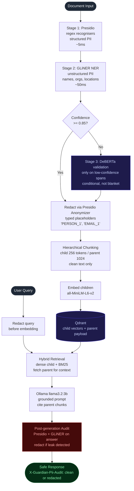

# Guardian RAG

> Privacy-safe RAG pipeline. Detects and redacts PII at ingestion, then audits
> every generated answer before it reaches the user. EU AI Act Article 10-aligned
> by design.
>
> **100% recall, 0.93 precision** on a 91-entity synthetic golden corpus.
> Run it yourself: `uv run python scripts/eval.py --with-gliner`.

[](https://github.com/adel-saoud/guardian-rag/actions/workflows/ci.yml)
[](https://github.com/adel-saoud/guardian-rag/actions/workflows/eval.yml)
[](https://www.python.org/)
[](https://github.com/astral-sh/ruff)
[](https://github.com/microsoft/pyright)
[](pyproject.toml)
[](LICENSE)

---

Standard RAG pipelines ingest documents, embed them, and return answers.
None of them ask: what if those documents contain names, IBANs, or passport
numbers?

**This one does.** Guardian RAG runs a two-stage PII detection pipeline
before any document enters the vector store, and audits every generated
answer before it reaches the user. PII is replaced with typed placeholders
so retrieval still works: `[PERSON_1] reported to [PERSON_2]` is useful
context; blank tokens are not.

> Inspired by operating DaiLY at Decathlon France, a RAG system serving
> 25,000 plus employees over HR documents where PII governance was a real
> concern, not a theoretical one.


---

## Try it (no API key needed)

```bash
git clone https://github.com/adel-saoud/guardian-rag
cd guardian-rag
uv sync --extra dev --extra ml --extra dashboard

# Step 1, regenerate the synthetic golden corpus (30 docs, 91 entities)
uv run python scripts/seed_demo_corpus.py

# Step 2, run the PII detection eval
uv run python scripts/eval.py --with-gliner
```

Expected output:

```
                  Guardian RAG, PII detection eval
┏━━━━━━━━━━━┳━━━━━━━━━┳━━━━━━━━━━┳━━━━━━━━━━━┳━━━━━━━━━━━━┳━━━━━━━━┳━━━━━━━━━━━┓
┃ Slice     ┃ Planted ┃ Detected ┃   R hits  ┃   P hits   ┃ Recall ┃ Precision ┃
┡━━━━━━━━━━━╇━━━━━━━━━╇━━━━━━━━━━╇━━━━━━━━━━━╇━━━━━━━━━━━━╇━━━━━━━━╇━━━━━━━━━━━┩
│ contracts │      30 │       64 │        30 │         53 │ 100.0% │      0.83 │
│ hr        │      31 │       55 │        31 │         53 │ 100.0% │      0.96 │
│ support   │      30 │       64 │        30 │         64 │ 100.0% │      1.00 │
├───────────┼─────────┼──────────┼───────────┼────────────┼────────┼───────────┤
│ overall   │      91 │      183 │        91 │        170 │ 100.0% │      0.93 │
└───────────┴─────────┴──────────┴───────────┴────────────┴────────┴───────────┘

PII Recall      100.0%
PII Precision   0.93
Faithfulness    N/A  (informational, requires Ollama)
Leaks caught    0  (post-generation audit)
```

**With Ollama** (for the full RAG path including generation and the
post-generation audit):

```bash
docker compose up -d ollama qdrant
docker compose exec ollama ollama pull llama3.2:3b
uv run python scripts/demo.py
```

Expected response headers on every `/v1/query`:

```
X-Guardian-Pii-Audit:    clean | redacted
X-Guardian-Chunks-Used:  <n>
X-Guardian-Faithfulness: <reserved, judge wiring is on the roadmap>
X-Guardian-Request-Id:   chatcmpl-<uuid>
```

## Open the dashboard

```bash
uv run streamlit run src/guardian_rag/dashboard/app.py
```

Three panels:

1. **PII Protection Stats**, aggregate counters, entity-type donut,
   leak captures.
2. **Redaction Explorer**, upload text, see entities highlighted in
   red, side-by-side with the typed-placeholder redaction.
3. **Eval Results**, per-category recall + precision gauges against
   the 30-document golden corpus.

---

## How it works



### Why three stages

| Detection type | Best tool | Why |
|:--|:--|:--|
| Structured PII (email, phone, IBAN, credit card, IP, SSN) | Presidio regex recognisers | Regex beats ML on deterministic patterns. 99%+ precision. |
| Unstructured PII (names, orgs, locations, implicit refs) | GLiNER NER | ML beats regex on contextual entities. F1 around 0.81 on multi-domain PII benchmarks. |
| Low-confidence GLiNER spans | DeBERTa validation pass | Conditional safety net. Fires only when GLiNER score is below `GUARDIAN_DEBERTA_THRESHOLD` (default 0.85). |

DeBERTa firing on every span would double inference cost. Firing only on
uncertain spans gives the safety net without the latency tax.

---

## Why not just use Presidio?

Presidio is a great PII library. It is not a RAG system. Guardian
wraps Presidio plus GLiNER, then adds the rest of the privacy-safe
pipeline on top.

| Problem | Approach |
|:--|:--|
| **Regex alone misses names, organisations, and locations** | GLiNER second stage catches contextual entities Presidio cannot match. |
| **ML alone is slow on deterministic patterns** | Presidio first stage handles emails, IBANs, credit cards, IPs in ~5 ms. |
| **Blank redaction breaks RAG context** | Typed placeholders preserve grammar so chunks remain useful for retrieval and generation. |
| **The LLM can paraphrase or hallucinate PII** | Post-generation audit re-runs the same detector over every answer before it reaches the user. |
| **Chunking forces a recall vs precision tradeoff** | Hierarchical chunking: child 256 tokens for precise retrieval, parent 1024 tokens for generation context. |
| **Same person under different names in different docs** | Cross-document entity resolution is roadmap. Within a single document, identical spans map to the same placeholder. |
| **Audit failures could leak unredacted text** | Fail-closed by default: any exception inside the audit returns a safe replacement, never the raw answer. |

---

## API surface

| Method | Path | Purpose |
|:--|:--|:--|
| `POST` | `/v1/ingest` | Detect, redact, chunk, embed, store |
| `POST` | `/v1/query` | Hybrid RAG + post-generation audit |
| `GET`  | `/v1/audit/{document_id}` | Full PII detection record |
| `GET`  | `/v1/stats` | Aggregate entity + leak counters |
| `GET`  | `/health` | Liveness |

---

## Project structure

```
src/guardian_rag/
├── config.py                  env-driven via pydantic-settings (GUARDIAN_*)
├── pii/                       3-stage detector, redactor, post-generation audit
├── ingestion/                 loader, hierarchical chunker, pipeline, redaction store
├── retrieval/                 embedder, Qdrant store, BM25 index, hybrid retriever
├── generation/                Ollama client, grounded prompt, citation verification
├── eval/                      golden corpus loader, recall + precision, judge
├── api/                       FastAPI surface (5 routes), lifespan, deps
└── dashboard/                 Streamlit, 3 panels (pyright-excluded)

scripts/
├── seed_demo_corpus.py        regenerate the 30-document golden dataset
├── eval.py                    PII recall + precision against the corpus
├── demo.py                    end-to-end local demo
└── composite_dashboard.py     2x2 README screenshot composite

context/
├── architecture.md
├── roadmap.md
└── decisions/                 7 ADRs
```

Full module map and design decisions in [`context/architecture.md`](context/architecture.md).

---

## Tech stack

| | Library / Tool | What it does |
|:--|:--|:--|
| **PII** | `presidio-analyzer` | Microsoft's open-source PII toolkit. Handles emails, IBANs, credit cards via regex. |
| | `gliner` | Small AI model (~100M params) that finds PII spans. You pass the entity types as a plain list at runtime, no per-use-case training. |
| | `transformers` | Runs the DeBERTa "is this actually a person name?" validator on borderline GLiNER spans. |
| **RAG** | `langchain-text-splitters` + `tiktoken` | Splits documents into the parent/child chunk hierarchy. |
| | `sentence-transformers` | MiniLM embeddings for dense retrieval. |
| | `qdrant-client` | Vector store. Real Qdrant in production, in-process for tests. |
| | `rank-bm25` | Keyword search alongside vector search so rare terms (IBANs, product codes) still rank. |
| **Generation** | `httpx` + `tenacity` | Async client for Ollama with retry. |
| **API** | `fastapi` + `uvicorn` | HTTP surface. |
| **Dashboard** | `streamlit` + `plotly` + `pandas` | 3-panel demo UI. |
| **Dev** | `uv` | Package manager + lockfile. |
| | `ruff` | Lint + format. |
| | `pyright` strict | Type checker. 0 errors, 0 warnings across the project. |
| | `pytest` + `pytest-asyncio` | Hermetic test suite. No network, no keys. |

---

## Configuration

All knobs are env-driven via `pydantic-settings` with the `GUARDIAN_` prefix.
The common ones:

| Variable | Default | Purpose |
|:--|:--|:--|
| `GUARDIAN_GLINER_MODEL` | `urchade/gliner_multi_pii-v1` | GLiNER model id |
| `GUARDIAN_DEBERTA_THRESHOLD` | `0.85` | Below this, DeBERTa validates GLiNER spans |
| `GUARDIAN_EMBEDDING_MODEL` | `sentence-transformers/all-MiniLM-L6-v2` | Retrieval embedder |
| `GUARDIAN_OLLAMA_MODEL` | `llama3.2:3b` | Generation model |
| `GUARDIAN_QDRANT_URL` | `http://localhost:6333` | Qdrant base URL |
| `GUARDIAN_AUDIT_FAIL_CLOSED` | `true` | Redact on audit error vs re-raise |

See [`src/guardian_rag/config.py`](src/guardian_rag/config.py) for the complete list.

---

## Honest limitations

- **30-document eval corpus.** Plenty for a portfolio demo. Production
  deployments need 1000+ documents and per-domain threshold calibration.
- **GLiNER may miss highly contextual PII.** Implicit references like
  "the CTO" pointing to a previously-named person are not yet resolved.
- **Typed placeholders break consistency across documents.** The same
  person under different names in different documents lands as
  different `[PERSON_n]` tokens. Cross-document entity resolution is
  [roadmap](context/roadmap.md).
- **Post-generation audit adds ~150 ms per query** on CPU. Acceptable
  for HR or contract workflows; not for sub-100ms SLAs.
- **Text PDFs only.** Scanned documents need OCR (out of scope).
- **Pseudonymisation, not anonymisation.** Re-identification by
  combining quasi-identifiers is theoretically possible.
- **"EU AI Act Article 10-aligned" describes design intent.** Actual
  compliance requires a DPIA and legal review for your specific
  deployment.

---

## Companion projects

- [llm-regression-detector](https://github.com/adel-saoud/llm-regression-detector), CI quality gate for LLM systems, catches accuracy drops before merge
- [llm-gateway](https://github.com/adel-saoud/llm-gateway), RAG-aware LLM gateway with per-stage cost attribution
- [llm-cost-autopilot](https://github.com/adel-saoud/llm-cost-autopilot), two-stage zero-shot complexity router that picks the cheapest capable model

Four projects, three axes:

- **Cost**: `gateway` tracks where the budget went; `autopilot` prevents it going to the wrong place.
- **Quality**: `detector` catches quality drops when prompts change.
- **Privacy**: `guardian` keeps personal data out of both the index and the response.

---

## License

[MIT](LICENSE), use it, fork it, ship it.
