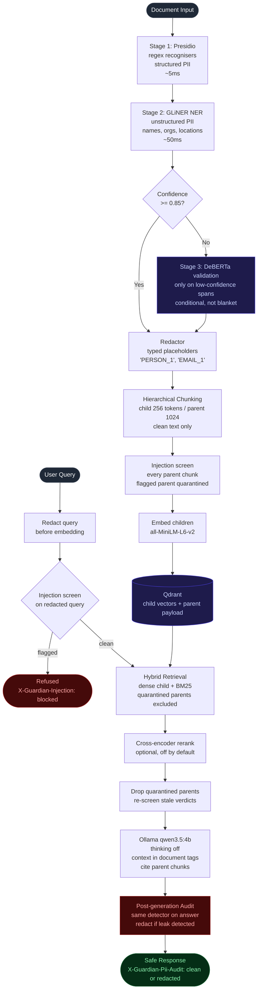

# Architecture

## Diagram

## Components

| Module | Role |
|:--|:--|
| `guardian_rag/config.py` | Pydantic `Settings`, env-driven via `GUARDIAN_*` ([configuration.md](configuration.md)) |
| `guardian_rag/pii/` | Three-stage PII detection and typed-placeholder redactor |
| `guardian_rag/pii/detector.py` | Orchestrates Presidio, GLiNER and DeBERTa |
| `guardian_rag/pii/audit.py` | Post-generation auditor, fail-closed |
| `guardian_rag/pii/_real_backends.py` | Lazy GLiNER and DeBERTa model loads (pyright-excluded) |
| `guardian_rag/ingestion/` | Loader, hierarchical chunker, pipeline, redaction store |
| `guardian_rag/retrieval/` | Embedder, Qdrant store, BM25 index, hybrid retriever, reranker |
| `guardian_rag/retrieval/_real_backends.py` | Lazy sentence-transformers embedder and cross-encoder (pyright-excluded) |
| `guardian_rag/injection/` | Injection screeners (classifier, rules, composite), quarantine helpers |
| `guardian_rag/injection/_real_backends.py` | Lazy HF injection classifier (pyright-excluded) |
| `guardian_rag/generation/` | Ollama client, grounded prompt, citation verification |
| `guardian_rag/eval/` | Golden corpus loader, PII runner, judge, ranking and injection metrics, in-domain corpus generator |
| `guardian_rag/api/` | FastAPI surface (5 routes, see [api.md](api.md)), lifespan, dependency container |
| `guardian_rag/dashboard/app.py` | Streamlit 3-panel dashboard (pyright-excluded) |
| `guardian_rag/dashboard/detector.py` | The dashboard's detector: the API's three stages, or Presidio alone with a warning when the `ml` extra is missing |

### Why three detection stages

| Detection type | Tool | Why |
|:--|:--|:--|
| Structured PII (email, phone, IBAN, credit card, IP, SSN) | Presidio regex recognisers | Regex beats ML on deterministic patterns. |
| Unstructured PII (names, orgs, locations, implicit refs) | GLiNER NER | ML beats regex on contextual entities. |
| Low-confidence GLiNER spans | DeBERTa validation pass | Fires only when the GLiNER score is below `GUARDIAN_DEBERTA_THRESHOLD` (default 0.85). |

DeBERTa on every span would double inference cost. Running it only on
uncertain spans keeps the safety net without the latency tax.

### What Guardian adds on top of Presidio

| Problem | Approach |
|:--|:--|
| Regex alone misses names, organisations and locations | GLiNER second stage catches contextual entities. |
| ML alone is slow on deterministic patterns | Presidio first stage handles emails, IBANs, cards and IPs. |
| Blank redaction breaks RAG context | Typed placeholders keep grammar, so chunks stay useful for retrieval and generation. |
| The LLM can paraphrase or hallucinate PII | The post-generation audit re-runs the detector over every answer. |
| Chunking forces a recall versus precision trade-off | Child 256 tokens for retrieval, parent 1024 tokens for generation context. |
| Retrieved documents can carry injected instructions | Parents screened at ingestion and quarantined when flagged; context spotlighted in the prompt. |

### Stack

| Area | Libraries |
|:--|:--|
| PII | `presidio-analyzer` (recognisers only, no NLP engine), `gliner`, `transformers` (DeBERTa validator); redaction is Guardian's own `Redactor` |
| RAG | `langchain-text-splitters` and `tiktoken` (chunking), `sentence-transformers` (embeddings and cross-encoder), `qdrant-client`, `rank-bm25` |
| Security | `transformers` (local injection classifier) |
| Generation | `httpx` and `tenacity` against Ollama |
| API | `fastapi`, `uvicorn` |
| Dashboard | `streamlit`, `plotly`, `pandas` |

## Data flow

**Ingest.** A document goes through Presidio, GLiNER and the conditional
DeBERTa pass, then the redactor replaces every span with a typed placeholder
and writes the redaction map to disk. The clean text is split into parents
and children. Every parent is screened for prompt injection; a flagged
parent is stored with `injection_quarantined=true` for audit but excluded
from dense search and BM25. Children are embedded and written to Qdrant with
the parent text in the payload.

**Query.** The query is redacted with the same detector, then screened. A
flagged query is refused before retrieval. Otherwise hybrid retrieval fuses
dense and BM25 scores over children, the optional cross-encoder reorders the
pool, and the parents of the top children are fetched. Parents whose stored
verdict came from a different screener, or from before v0.2, are re-screened.
The generator reads parents wrapped in `<document>` tags that the system
prompt marks as data. The post-generation audit runs last on every answer.

The LLM only sees redacted text and never the redaction map, so an injected
instruction cannot make it reveal original PII. Screening protects answer
integrity: an injection could still make the model ignore the context,
invent facts or send the user to a link.

## Failure modes

| Failure | Behaviour |
|:--|:--|
| Post-generation audit raises | Fail-closed by default (`GUARDIAN_AUDIT_FAIL_CLOSED=true`): the answer is replaced by a safe text, never returned raw. |
| Injection screener raises | Fail-closed: the query is refused, or the parent is quarantined. `off` is an explicit mode, logged as a warning at startup. |
| Reranker raises | Falls back to the fused hybrid order. |
| Ollama unreachable or returns 5xx | Retried with `tenacity`, then the request fails with an error. No unaudited answer can be returned. |
| Injection classifier false positive at ingestion | A real document is silently quarantined. This is why chunks use the `rules` screener by default ([ADR 0009](adr/0009-prompt-injection-screening.md)). |
| GLiNER misses a contextual entity | It reaches the index as plain text. The post-generation audit runs the same detector, so it can miss the same span again. |
| Misspelled or removed `GUARDIAN_*` variable | Startup stops with `UnknownSettingError` naming the closest valid setting, instead of silently keeping the default. |
| Ollama older than 0.17.5 or Qdrant older than 1.17.0 | Startup stops with `IncompatibleServiceError` naming the minimum, before any model loads (`service_versions.py`). |
| GLiNER redacts a company name as `[ORGANIZATION_n]` | Answers about that company lose it. Measured by `scripts/eval_faithfulness.py`, see the README Results. |

## Boundary contracts

Every cross-module boundary uses frozen `pydantic.BaseModel`s with
`ConfigDict(frozen=True, extra="forbid")`:

- `PiiEntity`, `RedactionMap`, `AuditResult` (`pii/models.py`)
- `InjectionVerdict` (`injection/models.py`)
- `Document`, `ParentChunk`, `ChildChunk`, `IngestionResult` (`ingestion/models.py`)
- `RetrievalHit`, `RetrievalResult` (`retrieval/models.py`)
- `ChatMessage`, `OllamaChatResponse`, `GroundedAnswer` (`generation/`)
- `GoldenDocument`, `GoldenEntity`, `EvalCounts`, `EvalReport` (`eval/models.py`), `DetectionCounts` (`eval/injection.py`)
- API request and response models (`api/schemas.py`)

## Lazy ML imports

Heavy ML backends (`gliner`, `transformers`, `sentence_transformers`,
including the cross-encoder and the injection classifier) are imported only
inside `_real_backends.py` constructors, never at module top level:

- `import guardian_rag.pii` does not load PyTorch.
- Tests substitute deterministic fakes that match the `Protocol` interface.
- CI runs the full suite without downloading weights.
- The FastAPI lifespan is the first place the heavy imports execute.

## Test strategy

- Hermetic: no network, no weights downloaded, no Docker.
- Deterministic: fake backends behind `Protocol` interfaces, hash-based
  embeddings, in-memory Qdrant.
- Coverage gate at 90%, enforced in `pyproject.toml`.
- Benchmarks are scripts, not tests: `scripts/eval.py`,
  `scripts/eval_retrieval.py`, `scripts/eval_injection.py` and
  `scripts/eval_faithfulness.py` need the `ml` and `bench` extras (and a
  local Ollama for faithfulness) and write JSON to `eval/results/`.
  `scripts/reproduce.py` runs all of them and writes `results/manifest.json`.

## Decision records

The ADRs in [`adr/`](adr/README.md) hold each significant decision, its
options and its measured consequences. Start with
[ADR 0010](adr/0010-three-stage-pii-detection.md).
